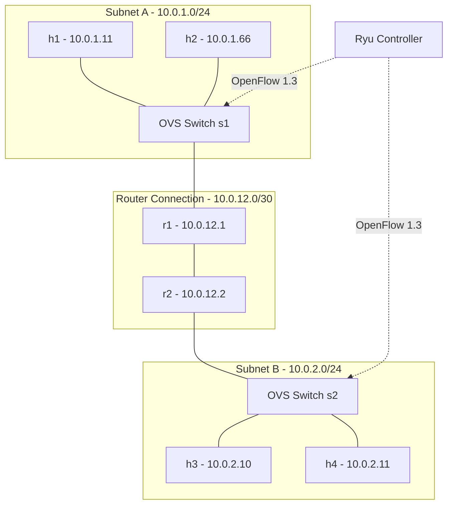

# SDN Network Telemetry and Traffic Anomaly Detection

A Software-Defined Networking (SDN) project built with **Ryu, OpenFlow 1.3, Mininet, and Open vSwitch** to monitor network traffic, extract flow-level features, detect suspicious activity, and automatically block suspicious source IP addresses.

[Repository](https://github.com/Asadahmed09/SDN-Traffic-Anomaly-Detection) · [Traffic Testing Guide](TRAFFIC_TESTING.md)

---

## Table of Contents

- [1. Project Overview](#1-project-overview)
- [2. Features](#2-features)
- [3. Architecture](#3-architecture)
- [4. Requirements](#4-requirements)
- [5. Installation](#5-installation)
- [6. Running the Project](#6-running-the-project)
- [7. Traffic Generation Guide](#7-traffic-generation-guide)
- [8. Anomaly Detection and Automatic Blocking](#8-anomaly-detection-and-automatic-blocking)
- [9. Monitoring and Logs](#9-monitoring-and-logs)
- [10. Packet Capture](#10-packet-capture)
- [11. Command Reference](#11-command-reference)
- [12. Troubleshooting](#12-troubleshooting)
- [13. Project Structure](#13-project-structure)

---

## 1. Project Overview

Traditional networks often rely on individual network devices to make forwarding decisions. Software-Defined Networking separates the control plane from the data plane, allowing a centralized controller to manage network behaviour.

This project demonstrates an SDN-based network monitoring and security system.

It creates a virtual network using Mininet, forwards traffic through Open vSwitch switches, and uses a Ryu controller to:

1. Collect OpenFlow flow statistics.
2. Extract traffic features such as packet rate and byte rate.
3. Detect port scanning and SYN-heavy traffic.
4. Generate alerts when configured thresholds are exceeded.
5. Install temporary OpenFlow rules to block suspicious source IP addresses.
6. Save monitoring data and alerts in CSV files.

The project is designed for controlled network experiments and demonstrations.

## 2. Features

| Feature | Description |
|---|---|
| SDN topology | Virtual network with hosts, routers, and OVS switches |
| OpenFlow 1.3 | Communication between switches and Ryu controller |
| Learning switch | Reactive MAC-based packet forwarding |
| Flow monitoring | Periodic collection of switch flow statistics |
| Feature extraction | Packet counts, byte counts, packet rate, and byte rate |
| Port scan detection | Detects multiple destination ports accessed by a source |
| SYN-heavy detection | Detects unusually high TCP SYN packet rates |
| Automatic mitigation | Installs temporary source-IP drop rules |
| CSV logging | Saves flow features and anomaly alerts |
| Packet capture | Captures TCP traffic for Wireshark analysis |

## 3. Architecture

### Network topology

The project contains two network subnets connected through two routers.



### Addressing plan

| Node | IP address | Role |
|---|---|---|
| h1 | 10.0.1.11/24 | Normal traffic source |
| h2 | 10.0.1.66/24 | Test and suspicious traffic source |
| r1 | 10.0.1.1/24, 10.0.12.1/30 | Router |
| r2 | 10.0.12.2/30, 10.0.2.1/24 | Router |
| h3 | 10.0.2.10/24 | Destination server |
| h4 | 10.0.2.11/24 | Additional host |
| s1 | OpenFlow switch | Connects h1, h2, and r1 |
| s2 | OpenFlow switch | Connects h3, h4, and r2 |

The Ryu controller connects to the switches through OpenFlow 1.3, normally using TCP port 6653.

## 4. Requirements

The project was developed and tested on Ubuntu 22.04.

### Required software

- Python 3
- Mininet
- Open vSwitch
- Ryu 4.34
- Nmap
- hping3
- iperf3
- curl
- tcpdump

Install the system packages:

```bash
sudo apt update

sudo apt install -y \
    git \
    python3 \
    python3-venv \
    python3-pip \
    mininet \
    openvswitch-switch \
    iperf3 \
    nmap \
    hping3 \
    curl \
    tcpdump
```

## 5. Installation

### Step 1: Clone the repository

```bash
git clone https://github.com/Asadahmed09/SDN-Traffic-Anomaly-Detection.git

cd SDN-Traffic-Anomaly-Detection
```

### Step 2: Create a Python virtual environment

```bash
python3 -m venv ~/ryu-env

source ~/ryu-env/bin/activate
```

### Step 3: Install Ryu

```bash
pip install ryu==4.34
```

### Step 4: Verify installation

```bash
ryu-manager --version
```

Keep the virtual environment available whenever you run the controller.

## 6. Running the Project

The controller and Mininet topology must run in separate Ubuntu terminals.

### Terminal 1 — Start the Ryu controller

Move to the project directory:

```bash
cd SDN-Traffic-Anomaly-Detection
```

Activate the virtual environment:

```bash
source ~/ryu-env/bin/activate
```

Set the Python module path:

```bash
export PYTHONPATH="$PWD:$PYTHONPATH"
```

Start the complete monitoring and mitigation controller:

```bash
ryu-manager controller.mitigation_switch
```

**Important:** Use `controller.mitigation_switch`, not `controller.learning_switch`. The mitigation controller includes the monitoring, anomaly detection, CSV logging, and automatic blocking modules.

Keep this terminal running.

### Terminal 2 — Start Mininet

Move to the project directory:

```bash
cd SDN-Traffic-Anomaly-Detection
```

Start the network:

```bash
sudo python3 run.py
```

Wait for:

```text
Network is ready. Entering Mininet CLI...
```

You should now see:

```text
mininet>
```

You can enter Mininet commands in this terminal.

### Verify the network

Display network nodes and interfaces:

```text
dump
```

Display the network links:

```text
net
```

Test connectivity:

```text
pingall
```

Test communication between h1 and h3:

```text
h1 ping -c 4 10.0.2.10
```

Successful replies indicate that connectivity is working.

## 7. Traffic Generation Guide

This section explains how to generate different traffic patterns and test the monitoring system.

**Where to run these commands:** At the `mininet>` prompt, unless stated otherwise.

### 7.1 Normal traffic

<details>
<summary><strong>A. ICMP — Ping and connectivity testing</strong></summary>

**Command:**

```text
h1 ping -c 10 10.0.2.10
```

**Purpose:**
- Tests connectivity between h1 and h3.
- Generates ICMP traffic.
- Displays packet loss and round-trip time.

Use this test before generating suspicious traffic to verify that the network works normally.

</details>

<details>
<summary><strong>B. HTTP — Generate web traffic</strong></summary>

**Step 1: Start an HTTP server on h3.**

```text
h3 python3 -m http.server 80 >/tmp/http.log 2>&1 &
```

**Step 2: Send a request from h1.**

```text
h1 curl http://10.0.2.10
```

**Purpose:**
- Starts a simple HTTP server.
- Generates client-to-server HTTP traffic.
- Allows the controller to observe ordinary TCP flows.

**Expected result:** An HTTP directory listing should be returned.

</details>

<details>
<summary><strong>C. iperf3 — Generate sustained TCP traffic</strong></summary>

**Step 1: Start the server on h3.**

```text
h3 iperf3 -s -D
```

**Step 2: Generate traffic from h1.**

```text
h1 iperf3 -c 10.0.2.10 -t 10
```

**Purpose:**
- Generates sustained TCP traffic.
- Measures throughput.
- Produces measurable packet and byte counters.

**Expected result:** iperf3 displays the throughput achieved during the test.

</details>

### 7.2 Suspicious traffic patterns

These commands are intended for your own isolated Mininet lab. They generate test traffic for the project's detection logic.

<details>
<summary><strong>D. Nmap — Simulate a port scan</strong></summary>

Run the scan from h2:

```text
h2 nmap -sS -p 1-100 10.0.2.10
```

**What it does:**

- Sends TCP SYN probes to multiple destination ports.
- Creates multiple destination-port flow entries.
- Provides input for the port-scan detection module.

**Detection condition:**

The detector raises a port-scan alert when more than 20 distinct destination ports are observed from the same source to the same destination within a 10-second window.

**Expected behaviour:**

1. The Ryu controller detects the suspicious pattern.
2. An anomaly alert appears in the controller terminal.
3. The mitigation module attempts to block the source IP.
4. The action is recorded in `alerts.csv`.

</details>

<details>
<summary><strong>E. hping3 — Generate repeated TCP SYN packets</strong></summary>

Run from h2:

```text
h2 hping3 -S -p 80 -c 600 -i u1000 10.0.2.10
```

**What it does:**

- Generates TCP SYN packets.
- Sends them to destination port 80 on h3.
- Produces traffic for testing SYN-rate monitoring.

**Detection condition:**

The detector raises a SYN-heavy alert when the observed SYN packet rate exceeds 500 packets per second within a 1-second window.

**Important:** The command generates a bounded set of 600 packets. Actual detection depends on the observed rate, flow-statistics collection, and timing. Running the command alone does not guarantee an alert.

</details>

### 7.3 Test traffic summary

| Test | Source | Destination | Traffic type |
|---|---|---|---|
| Ping | h1 | h3 | ICMP |
| HTTP | h1 | h3 | TCP |
| iperf3 | h1 | h3 | Sustained TCP |
| Nmap | h2 | h3 | TCP SYN port scan |
| hping3 | h2 | h3:80 | Repeated TCP SYN |

For additional traffic examples, see [TRAFFIC_TESTING.md](TRAFFIC_TESTING.md).

## 8. Anomaly Detection and Automatic Blocking

The project has two main detection categories.

### 8.1 Port scan detection

| Parameter | Value |
|---|---:|
| Distinct destination port threshold | More than 20 |
| Detection window | 10 seconds |

The detector tracks destination ports associated with a source and destination IP pair.

When the number of distinct ports exceeds the configured threshold, it generates a port-scan alert.

### 8.2 SYN-heavy traffic detection

| Parameter | Value |
|---|---:|
| SYN packet rate threshold | More than 500 packets/second |
| Detection window | 1 second |

The detector monitors TCP SYN flow statistics and checks the observed packet rate.

### 8.3 Automatic mitigation

When an anomaly is detected, the mitigation module attempts to install a drop rule for the suspicious source IP.

The rules are installed on the connected OpenFlow switches.

| Parameter | Value |
|---|---|
| Block priority | 20 |
| Blocking duration | 60 seconds |
| Matching condition | IPv4 source address |
| Mitigation | Drop matching traffic |
| Switch coverage | Connected switches |

Certain infrastructure and destination IP addresses are whitelisted and are not blocked by this mechanism.

### 8.4 Demonstrate automatic blocking

**Step 1: Generate a port scan from h2.**

```text
h2 nmap -sS -p 1-100 10.0.2.10
```

**Step 2: Observe the Ryu controller terminal.**

Look for an anomaly alert and a blocking message.

**Step 3: Test the suspicious source.**

```text
h2 ping -c 4 10.0.2.10
```

If h2 has been blocked, the test traffic should not reach h3.

**Step 4: Test a normal source.**

```text
h1 ping -c 4 10.0.2.10
```

The normal source should remain able to communicate.

**Step 5: Verify recovery.**

Wait at least 60 seconds after the block rule is installed, then test again:

```text
h2 ping -c 4 10.0.2.10
```

The temporary blocking rule should have expired.

**Note:** Blocking is automatic. There is no separate manual block/unblock CLI command in the current implementation. The controller installs a temporary rule when it receives a qualifying anomaly alert.

## 9. Monitoring and Logs

The monitoring module periodically requests OpenFlow flow statistics from the connected switches.

The feature extraction module calculates traffic changes between consecutive statistics samples.

The mitigation controller writes the resulting data to CSV files.

By default, logs are saved in:

```text
~/sdn_logs/
```

The directory can be changed using the `SDN_LOG_DIR` environment variable before starting the controller.

### 9.1 View the log directory

From an Ubuntu terminal:

```bash
ls -lh ~/sdn_logs
```

### 9.2 Flow features

File:

```text
~/sdn_logs/features.csv
```

Contains collected flow information and extracted traffic features, including:

- Source and destination IP addresses.
- Packet and byte counters.
- Packet and byte changes between samples.
- Packet rate.
- Byte rate.
- Flow and switch information.

View the latest records:

```bash
tail -n 10 ~/sdn_logs/features.csv
```

### 9.3 Anomaly alerts

File:

```text
~/sdn_logs/alerts.csv
```

Contains detected anomalies and mitigation actions.

View the latest alerts:

```bash
tail -n 10 ~/sdn_logs/alerts.csv
```

Watch new alerts as they are written:

```bash
tail -f ~/sdn_logs/alerts.csv
```

Press `Ctrl + C` to stop following the file.

### 9.4 Log file summary

| File | Purpose |
|---|---|
| `features.csv` | Flow statistics and extracted traffic features |
| `alerts.csv` | Anomaly information and mitigation action |

The CSV files are appended to during controller operation.

## 10. Packet Capture

The project includes a packet capture script:

```text
scripts/capture.sh
```

It captures TCP traffic on two switch interfaces and saves the resulting PCAP files.

### Run a capture

Keep the Mininet network running.

Open a separate Ubuntu terminal in the project directory:

```bash
bash scripts/capture.sh
```

By default, the capture duration is 20 seconds.

### Custom capture name and duration

```bash
bash scripts/capture.sh demo 30
```

This uses:
- Capture name: `demo`
- Duration: 30 seconds

### Output files

Captures are saved in:

```text
~/sdn_captures/
```

The script generates:

```text
demo_s1-eth2.pcap
demo_s1-eth3.pcap
```

Open these files in Wireshark for packet-level analysis.

### Useful Wireshark filters

| Filter | Purpose |
|---|---|
| `tcp` | Show TCP packets |
| `tcp.flags.syn == 1` | Show SYN packets |
| `tcp.flags.syn == 1 && tcp.flags.ack == 0` | Show initial SYN packets |
| `tcp.flags.ack == 1` | Show ACK packets |
| `http` | Show HTTP packets |
| `ip.addr == 10.0.2.10` | Filter traffic involving h3 |

## 11. Command Reference

This section provides a quick reference to the main commands used in the project.

### Ubuntu terminal commands

| Command | Purpose |
|---|---|
| `source ~/ryu-env/bin/activate` | Activate the Ryu environment |
| `export PYTHONPATH="$PWD:$PYTHONPATH"` | Set Python module path |
| `ryu-manager controller.mitigation_switch` | Start the monitoring and mitigation controller |
| `sudo python3 run.py` | Start the Mininet topology |
| `bash scripts/capture.sh` | Capture TCP traffic |
| `bash scripts/capture.sh demo 30` | Capture using a custom name and duration |
| `ls -lh ~/sdn_logs` | List generated logs |
| `tail -f ~/sdn_logs/alerts.csv` | Follow anomaly alerts |

### Mininet CLI commands

| Command | Purpose |
|---|---|
| `nodes` | List network nodes |
| `dump` | Display node and interface information |
| `net` | Display network links |
| `pingall` | Test connectivity between hosts |
| `h1 ping -c 10 10.0.2.10` | Generate ICMP traffic |
| `h1 curl http://10.0.2.10` | Generate HTTP traffic |
| `h1 iperf3 -c 10.0.2.10 -t 10` | Generate sustained TCP traffic |
| `h2 nmap -sS -p 1-100 10.0.2.10` | Simulate a port scan |
| `h2 hping3 -S -p 80 -c 600 -i u1000 10.0.2.10` | Generate TCP SYN traffic |
| `exit` | Stop Mininet and leave its CLI |

## 12. Troubleshooting

<details>
<summary><strong>1. Ryu command not found</strong></summary>

Activate the virtual environment:

```bash
source ~/ryu-env/bin/activate
```

If Ryu is not installed:

```bash
pip install ryu==4.34
```

</details>

<details>
<summary><strong>2. Python cannot find the controller or analysis modules</strong></summary>

From the project directory, set:

```bash
export PYTHONPATH="$PWD:$PYTHONPATH"
```

Then start the controller again.

</details>

<details>
<summary><strong>3. Mininet cannot connect to the controller</strong></summary>

Check that:

- The Ryu controller is running.
- The controller was started before the topology.
- The controller is listening on the expected OpenFlow port.
- Open vSwitch is running.

Check the Open vSwitch service:

```bash
sudo systemctl status openvswitch-switch
```

</details>

<details>
<summary><strong>4. Hosts cannot communicate</strong></summary>

From the Mininet CLI:

```text
pingall
```

Check the topology:

```text
net
```

Check host addresses and interfaces:

```text
dump
```

</details>

<details>
<summary><strong>5. CSV log files are missing</strong></summary>

Check the controller terminal for the log directory message.

Then inspect:

```bash
ls -lh ~/sdn_logs
```

Make sure the `controller.mitigation_switch` application is running.

</details>

<details>
<summary><strong>6. Anomaly is not detected</strong></summary>

Check that:

- The mitigation controller is running.
- The switches are connected to Ryu.
- The test traffic is being generated from the intended source.
- The traffic meets the configured detection threshold.
- You are checking the correct controller terminal.

Generating suspicious traffic does not guarantee an alert unless the detection conditions are met.

</details>

## 13. Project Structure

```text
SDN-Traffic-Anomaly-Detection/
│
├── analysis/
│   ├── detector.py
│   ├── features.py
│   └── records.py
│
├── controller/
│   ├── learning_switch.py
│   ├── monitor_switch.py
│   └── mitigation_switch.py
│
├── scripts/
│   └── capture.sh
│
├── tests/
│
├── topology/
│   └── topology.py
│
├── run.py
├── README.md
└── TRAFFIC_TESTING.md
```

| Component | Responsibility |
|---|---|
| `run.py` | Starts the Mininet network |
| `topology/` | Defines hosts, switches, routers, and links |
| `controller/learning_switch.py` | Provides MAC-learning forwarding |
| `controller/monitor_switch.py` | Collects flow statistics and invokes detection |
| `controller/mitigation_switch.py` | Handles alerts, blocking, and CSV logging |
| `analysis/features.py` | Extracts traffic features from flow statistics |
| `analysis/detector.py` | Detects port scans and SYN-heavy traffic |
| `analysis/records.py` | Defines data structures for samples, features, and alerts |
| `scripts/capture.sh` | Captures TCP packets into PCAP files |
| `TRAFFIC_TESTING.md` | Additional traffic-generation instructions |

---

## Stopping the Project

1. In the Mininet terminal, run:

```text
exit
```

2. In the Ryu terminal, press:

```text
Ctrl + C
```

3. If you started any separate packet-capture process, allow it to finish or stop it as appropriate.

---

## Notes and Limitations

- This project is intended for controlled lab environments.
- Detection depends on the configured thresholds and the flow statistics available to the controller.
- Automatic mitigation applies temporary drop rules; it is not a permanent firewall configuration.
- The current implementation detects port scans and SYN-heavy traffic. It should not be described as detecting every possible network attack.
- Packet captures and CSV logs are generated at runtime and are not required to be present before starting the project.

